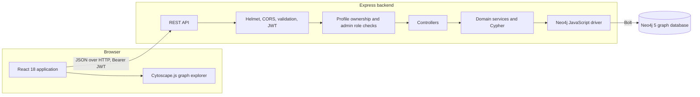
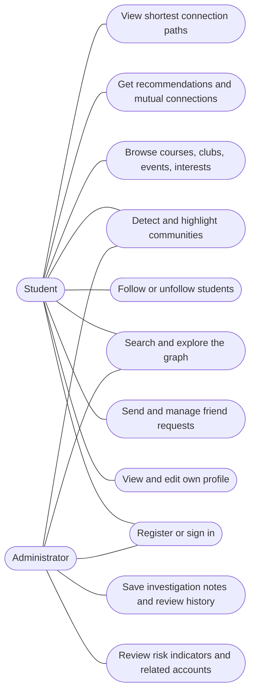
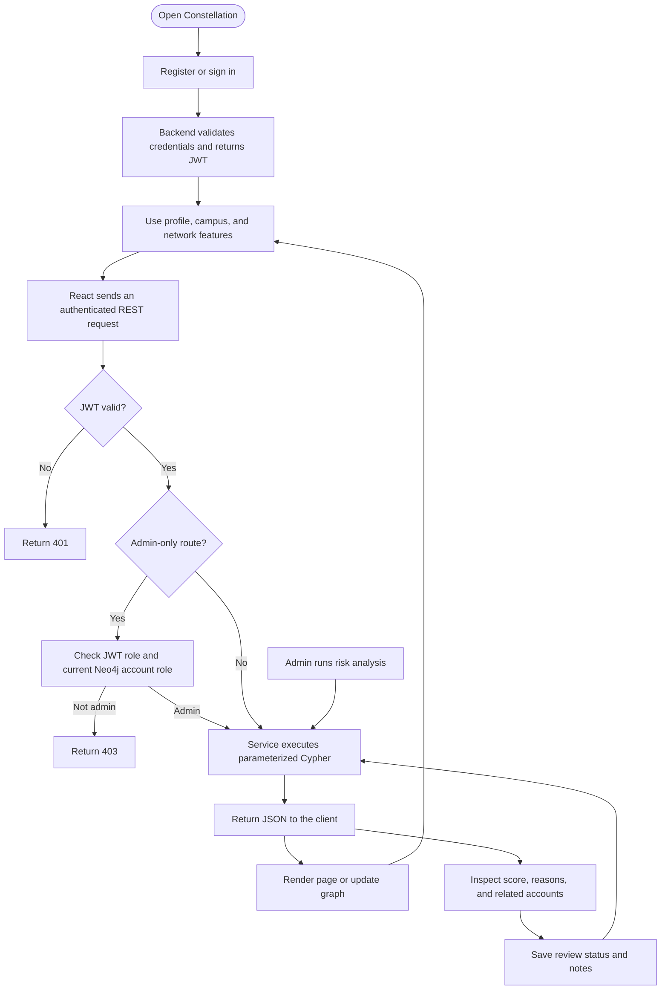
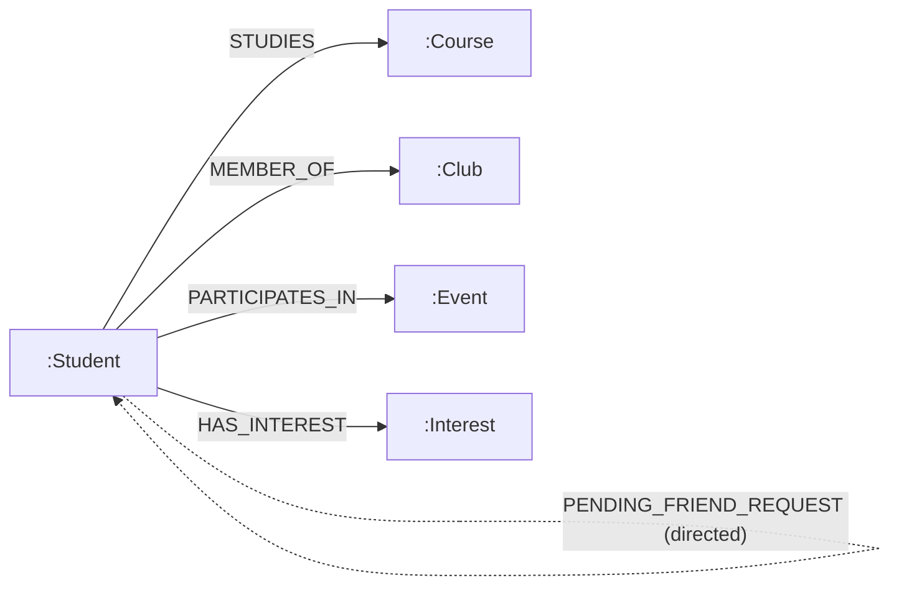

# Constellation

Constellation is a campus social-network application built with React, Express, and Neo4j. Students can discover classmates through academic and social graph relationships; administrators can review explainable risk indicators and investigate the network. Risk indicators are decision-support signals, not proof of fraud, and do not trigger automatic account restrictions.

## Problem statement and objectives

Campus communities have relationships that are awkward to represent as isolated records: students share classes, clubs, events, interests, and friendships. Constellation stores these entities and connections as a graph so the application can traverse and visualize them directly.

Project objectives:

- Provide authentication and student profile management.
- Support friendships, friend requests, following, courses, clubs, events, and interests.
- Recommend students from explainable shared-connection signals.
- Explore relationships, communities, and shortest paths through an interactive graph.
- Help administrators review suspicious patterns with scores, reasons, related accounts, notes, and review history.
- Keep Neo4j access on the backend; the React application calls REST APIs and never connects directly to Neo4j.

## System architecture



### Technology stack

| Layer | Technologies |
| --- | --- |
| Frontend | React 18, Vite, React Router, Axios, Tailwind CSS, Cytoscape.js |
| Backend | Node.js, Express 4, express-validator, Helmet, JWT, bcryptjs |
| Database | Neo4j Community 5.26, Cypher, neo4j-driver 5 |
| Local database | Docker Compose; APOC is configured, but Graph Data Science (GDS) is not required or installed |

## Use cases



## Activity flow



## Neo4j graph schema



`PENDING_FRIEND_REQUEST` is part of the application schema but is not one of the six relationship types drawn by the interactive graph explorer.

### Constraints and indexes

`npm run db:init` creates or verifies six uniqueness constraints:

- `Student.studentId` and `Student.email`
- `Course.courseCode`
- `Club.clubId`
- `Event.eventId`
- `Interest.name`

It also creates five explicit property indexes for student department, year, and name; course department; and event date. Neo4j additionally creates backing indexes for uniqueness constraints.

## Modules

- **Authentication and profiles:** Registration hashes passwords with bcryptjs (10 salt rounds); login issues signed JWTs. Profile updates require authentication, validation, and ownership checks. Student response sanitization omits `passwordHash`.
- **Friendships and following:** Friend-request lifecycle, mutual friendships, follower/following lists, and duplicate-action handling.
- **Campus records:** Browse and manage course enrollment, club membership, event participation, and interests.
- **Recommendations and connections:** Rank eligible students using shared graph context; show mutual connections and paths.
- **Community analysis:** Detect groups using deterministic label propagation over undirected `FRIENDS_WITH` edges.
- **Fraud and risk analysis:** Compute rule-based indicators from relationship structure, activity, and academic engagement. Scores explain which rules contributed.
- **Administrator investigation:** Dashboard counts and risk distribution, flagged profiles, suspicious connections, review status, investigation notes, and history. `/api/admin/*` uses JWT authentication, requires the `admin` claim, and checks the current Neo4j role before allowing access.
- **Interactive graph:** Cytoscape.js renders Student, Course, Club, Event, and Interest nodes with `FRIENDS_WITH`, `FOLLOWS`, `STUDIES`, `MEMBER_OF`, `PARTICIPATES_IN`, and `HAS_INTEREST` relationships. Search, relationship filters, selection details, connected-student highlighting, community/risk highlighting, and shortest-path display use backend APIs.

### Recommendation algorithm

The recommendation query calculates a weighted score from shared graph context:

| Signal | Weight |
| --- | ---: |
| Mutual friends | 5 per student |
| Shared courses | 3 per course |
| Shared interests | 3 per interest |
| Shared clubs | 2 per club |
| Shared events | 1 per event |

Candidates are excluded if they are the requesting student, already friends, or have a pending friend request in either direction. A candidate must have at least one shared signal. Returned results include the score breakdown and reasons.

### Community detection methodology

Community detection runs deterministic label propagation in application code, using only confirmed `FRIENDS_WITH` edges. Student IDs are sorted and ties are resolved deterministically; the algorithm runs for at most 30 iterations. Community density is internal friendship edges divided by the number of possible pairs. This is a lightweight heuristic, not Louvain or a GDS procedure. The current Docker configuration does not include GDS.

### Fraud detection and risk scoring

The explainable suspicious-activity analysis uses configurable defaults and accumulates points, capped at 100:

| Indicator | Default condition | Points |
| --- | --- | ---: |
| High friend count | More than 30 confirmed friends | 25 |
| Rapid growth | At least 5 friendships in the last 24 hours | 30 |
| Dense, low-engagement group | Community size at least 4, density at least 0.75, and at least 75% of members have no recorded course, club, or interest | 25 |
| Few meaningful connections | At most 1 friend, no course/club/interest activity, and account age at least 7 days | 15 |
| Unusual relationship structure | At least 8 friends, clustering at most 0.1, follows someone, and reciprocity at most 0.2 | 25 |

Risk levels default to Low below 30, Medium from 30 to below 60, and High from 60. Analysis persists reasons and metrics for administrator review. These thresholds are heuristics and require human interpretation.

There are also older fraud and enhanced-admin recalculation routes with separate heuristics and thresholds. They write overlapping risk properties; scores from those routes should not be treated as directly interchangeable with the explainable analysis above. This is a known area for future consolidation.

### Important Cypher patterns

The backend uses uniqueness constraints plus `MERGE` for idempotent creation. For example, an accepted friendship is modeled as an undirected relationship:

```cypher
MATCH (a:Student {studentId: $studentIdA})
MATCH (b:Student {studentId: $studentIdB})
MERGE (a)-[:FRIENDS_WITH]-(b);
```

The path finder can query any two selected students through the authenticated `GET /api/recommendations/path/:studentIdA/:studentIdB?maxHops=6` endpoint. The requested hop count is capped at 10; the Cypher traversal uses a literal maximum and filters by the requested count:

```cypher
MATCH path = shortestPath(
  (a:Student {studentId: $studentIdA})
  -[:FRIENDS_WITH|STUDIES|MEMBER_OF|PARTICIPATES_IN|HAS_INTEREST*1..10]-
  (b:Student {studentId: $studentIdB})
)
WHERE length(path) <= $maxHops
RETURN nodes(path), length(path);
```

The separate fraud-analysis path endpoint remains limited to eight hops.

Recommendation scoring traverses shared graph neighborhoods:

```cypher
OPTIONAL MATCH (me)-[:FRIENDS_WITH]-(mutual:Student)-[:FRIENDS_WITH]-(candidate)
OPTIONAL MATCH (me)-[:STUDIES]->(course:Course)<-[:STUDIES]-(candidate)
OPTIONAL MATCH (me)-[:HAS_INTEREST]->(interest:Interest)<-[:HAS_INTEREST]-(candidate)
```

The production query collects distinct shared items, applies the weights above, filters ineligible candidates, and sorts by score.

## Installation and execution

Requirements: Node.js 20 or newer, npm, and Docker (or a reachable Neo4j 5 database).

1. Start the local database:

   ```bash
   docker compose up -d
   ```

2. Configure `backend/.env` from `backend/.env.example`. The Compose defaults use `neo4j` / `campusgraph_password`; set a private `JWT_SECRET` and suitable database credentials for non-demo use.

3. Install dependencies from the two package directories:

   ```bash
   cd backend
   npm ci
   cd ../frontend
   npm ci
   ```

4. Initialize schema and, only for a disposable database, add the sample graph:

   ```bash
   cd ../backend
   npm run db:init
   npm run db:seed
   ```

   **Warning:** `db:seed` currently deletes all nodes in the configured database before inserting fixtures. Do not run it against data that must be retained.

5. Start the backend and frontend in separate terminals:

   ```bash
   cd backend
   npm run dev
   ```

   ```bash
   cd frontend
   npm run dev
   ```

   The default URLs are `http://localhost:5000` for the API and `http://localhost:5173` for the frontend.

The seeded demo accounts use `Password123!`. These are fixtures only; change or remove them before any non-demo deployment.

### Administrator setup

New accounts are students. An authorized database operator can promote an account:

```cypher
MATCH (s:Student {email: 'admin@example.edu'})
SET s.role = 'admin';
```

Replace the example email with the intended account. The administrator must sign in again after promotion so the JWT includes the role. The API also checks the current Neo4j role on each administrator request. Risk flags are review signals only; the application does not automatically ban accounts.

After signing in, administrators can use **Admin Investigation** for risk reviews and **Campus Catalog** to add or update courses and clubs, and create campus events. Course department is used for subject grouping; subjects are not separate graph nodes. Course and club records are upserted by their IDs, while new events receive an ID automatically if one is not supplied. Catalog APIs are protected by the administrator role.

## Tests and verification

Run backend scripts from `backend/`. The integration scripts need a seeded Neo4j database and several mutate fixture relationships or account properties. Use a disposable database, not valuable user data.

```bash
npm run test:auth
npm run test:audit
npm run test:recommendations
npm run test:fraud
npm run test:relationships
npm run test:friendship
npm run test:following
npm run test:phase3c
npm run test:admin-dashboard
npm run test:graph-analysis
```

Build the frontend with:

```bash
cd frontend
npm run build
```

### Final integration pass results

The following checks were run after clean `npm ci` installs, against a temporary isolated Neo4j 5.26.0 Community database initialized from the project schema and seed script:

- All 10 backend test scripts above exited successfully. `test:relationships` reported 55 passed, 0 failed, and 0 skipped; the auth suite reported 8 passing checks; graph-analysis reported 3 passing tests.
- Schema initialization reported all 6 uniqueness constraints and all 5 explicit indexes applied. Neo4j reported all 13 indexes (including constraint-backed indexes) ONLINE.
- Direct duplicate-insert checks for each of the 6 unique keys were rejected by Neo4j constraints.
- `EXPLAIN` for a student-ID lookup used `NodeUniqueIndexSeek`.
- `npm run build` succeeded. Vite emitted a chunk-size advisory for the 909.61 kB JavaScript bundle (268.68 kB gzip).
- Manual browser smoke checks in the preceding integration work exercised graph search, relationship filters, zoom, shortest-path display, and administrator review/history.
- Production dependency audits found no backend production advisories. The frontend production dependency audit reported 2 moderate React Router advisories. Full audits also reported 2 moderate backend development-dependency advisories and frontend Vite/esbuild development-dependency advisories, including 1 high severity finding. Major-version dependency upgrades were not made during this integration pass.

These are targeted integration and smoke checks, not a production-scale load or penetration test. The query-plan check covered the indexed student-ID lookup only; no broad performance benchmark was run. No automated frontend test script is defined.

## Known limitations

- Community detection is deterministic label propagation and can produce heuristic groupings; GDS is not installed.
- The risk-scoring routes overlap and persist different scoring models; consolidate them before using scores as a single operational metric.
- Risk scores and seed data are illustrative and are not calibrated for real fraud decisions.
- The frontend bundle is large and has a Vite chunk-size warning.
- Dependency audit findings listed above remain unresolved; the React Router production advisories and development-tool advisories should be addressed in a separately tested dependency upgrade.
- The default development JWT secret and Compose database credentials are public project defaults. Production deployments must supply strong secrets and restrict database/network access.
